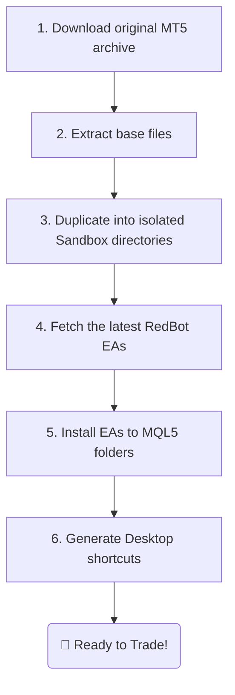

# 🤖 RedBot Manager - Portable MT5 Multi-Instance Deployer

> **The ultimate solution for algorithmic traders (Algo Traders).** Initialize, configure, and manage dozens of isolated MetaTrader 5 portable instances in a single click, pre-integrated with the automated robot ecosystem from **RedBot AI**.

---

## 💡 The Pain of Algo Trading & The RedBot Manager Solution

Running dozens of trading robots (Expert Advisors - EAs) on a single server or VPS is typically:
*   ❌ **Manual & Time-Consuming:** You must install MT5 repeatedly or copy-paste setup folders indefinitely.
*   ❌ **Prone to Clutter & Conflict:** Config files, accounts, cache, and history can overlap, leading to system crashes.
*   ❌ **Resource-Heavy:** Standard installations consume massive VPS RAM and CPU resources.
*   ❌ **Tedious EA Configuration:** Each time you update a bot, you have to download the `.ex5` file and manually locate the correct MQL5 directory for every instance.

**RedBot Manager solves all these challenges.** Powered by **Tauri & Rust**, this ultra-lightweight desktop tool automates 100% of the downloading, extraction, sandbox isolation, robot installation, and desktop shortcut generation processes for multiple MT5 accounts simultaneously.

---

## ⚡ Key Features

### 1. Batch Portable Sandbox Deployment
Instead of standard system-wide installs, RedBot Manager deploys MetaTrader 5 in **Portable Mode** (`/portable`).
*   Each MT5 instance runs as an entirely isolated sandbox with its own dedicated local data directory (no shared config in `AppData`).
*   Create **5, 10, or 50 instances** simultaneously with a single form.

### 2. RedBot EAs Auto-Installer
No more manual copy-pasting of binary files. RedBot Manager:
1.  Downloads the latest versions of **RedBot Expert Advisors** from RedBot AI's secure distribution servers.
2.  Resolves target paths, extracts archives, and automatically copies the EAs to the correct `/MQL5/Experts` directory of each sandbox.

### 3. Automated Desktop Shortcut Generator
The application auto-generates launcher shortcuts on your Desktop for every deployed instance.
*   These shortcuts are pre-configured with the `/portable` startup argument.
*   Names are synchronized using your custom naming pattern, allowing you to launch specific accounts immediately.

### 4. High Performance & VPS Optimization
*   **Low RAM Footprint:** Written in Rust instead of resource-heavy frameworks like Electron, RedBot Manager's UI consumes only **~30MB RAM** during operation.
*   **Multithreaded Execution:** Copying files, downloading EAs, and writing configs are processed in parallel threads, configuring 10 VPS sandboxes in **under 60 seconds**.

---

## 🛠 6-Step Automated Workflow

RedBot Manager visualizes the real-time installation steps through a graphical timeline:

---

## 🚀 Quick Start Guide

1.  **Download:** Fetch the latest `redbot-manager.exe` from the [Releases](https://github.com/Redbot-EA/redbot-manager/releases) page.
2.  **Run:** This app is fully **Portable**. Double-click to run it instantly without installation.
3.  **Configure:**
    *   **Prefix Name:** Naming prefix for the instances (e.g., `RedBot_Account`).
    *   **Quantity:** Number of instances to deploy (e.g., `5`).
    *   **Install Path:** Target directory for deployment (e.g., `C:\Trading\Instances`).
4.  **Deploy:** Click **Create** and watch the stage timeline. Once completed, click **Launch** or start instances directly from your Desktop shortcuts.

---

## 🔒 Security & Data Isolation

*   **100% Clean:** Source code builds are audited and compiled securely via automated GitHub Actions.
*   **Strict Isolation:** Bot credentials, API keys, and configuration parameters are stored locally within each sandbox directory. No cross-sharing, minimizing data leak risks.

---

## 📞 Support & Credits

Developed and maintained by **RedBot AI**.
*   **Website:** [redbot.trade](https://redbot.trade)
*   **Telegram Community:** [@RedBotTrading](https://t.me/RedBotTrading)
*   **Copyright:** © 2026 RedBot AI. All rights reserved.
